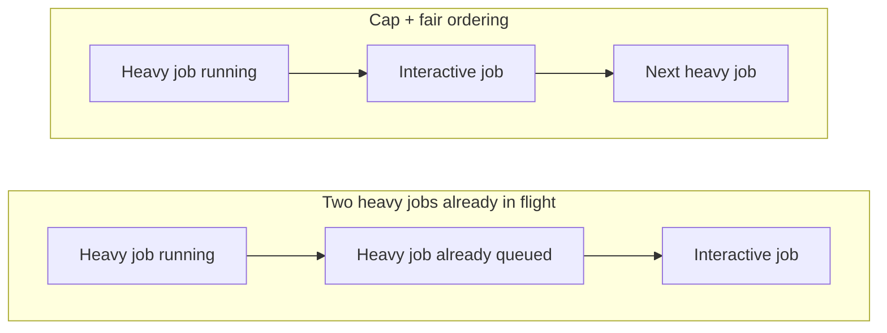

# DRM GPU scheduling

**Keep interactive frames moving when the GPU is busy.**

An experimental Linux DRM scheduler change that combines a limit on in-flight
GPU work with fair scheduling. The goal: let apps and the desktop get GPU time
sooner while a heavy graphics workload is running, without requiring application
changes.

**Early hardware results: ~6 ms of app GPU wait, versus ~14 ms in earlier
stock-FIFO sessions.** The Hyprland compositor's wait fell from roughly 10–13 ms
to 3–4 ms in the same historical comparison.

[Hardware results](#hardware-results) · [How it works](#how-it-works) ·
[Explore and reproduce](#explore-and-reproduce) · [Project status](plan.md)

## Hardware results

Measured on a **Radeon 860M / Ryzen AI 7 350** laptop running Hyprland, with a
synthetic Vulkan burst client competing against a heavy Vulkan workload
(`vk-hog`, approximately 8 ms per GPU job). Lower wait is better.

| Kernel-side wait until GPU start | Earlier stock FIFO | Fair + cap prototype |
|---|---:|---:|
| App median (p50) | 13.2–15.4 ms | **5.31–6.21 ms** |
| App 99th percentile (p99) | 16.4–18.0 ms | **8.60–8.80 ms** |
| Hyprland compositor median (p50) | 9.8–13.0 ms | **3.35–3.77 ms** |

That is roughly **8 ms less app wait** in this comparison. For scale, one refresh
at 60 Hz takes 16.7 ms. Getting a frame onto the GPU sooner can help it reach a
refresh deadline; the measurement here is **GPU scheduling wait**, not total
input-to-display latency or game FPS.

> **Preliminary evidence, as of November 4, 2026.** The prototype numbers span
> three runs on one boot of `7.2.11-arch1-1-drmsched`. Stock numbers come from
> earlier `7.2.11-arch1-1` sessions with older userspace. Display configurations
> also differed across the study. These are observed ranges, not confidence
> intervals or a controlled estimate of the improvement. A paired boot study is
> the next step.

The heavy workload sustained about 117 jobs/s in capped traces versus about
118 jobs/s in earlier uncapped traces. This is an encouraging throughput hint;
its cost still needs a controlled measurement, including workloads that submit
multiple jobs per frame.

Source: [first-boot report, run IDs and limitations](trace/reports/kernel-cap-first-boots.md).
Throughput observations and the planned comparison are in [plan.md](plan.md#next-steps).

## How it works

On the tested graphics scheduler, two submission credits allow a heavy workload
to keep two jobs in flight. A short interactive job can arrive while one heavy
job runs and another is already committed ahead of it. Changing which client
the scheduler picks next cannot reclaim that occupied queue slot.

The prototype combines three pieces:

1. **Limit in-flight work.** Allow at most one NORMAL/LOW job in flight across
   each graphics scheduler. This includes interactive NORMAL jobs. HIGH/KERNEL
   jobs are exempt from the extra cap and still obey the original total credits.
2. **Choose by GPU service.** Use the existing fair policy to favor an entity
   that has received less weighted GPU time when the next slot becomes available.
3. **Skip cap-blocked entities.** Let selection pass an entity blocked by the
   extra cap so eligible work, including the HIGH-priority compositor, can proceed.

Illustrative execution order when an interactive job arrives during a heavy job:



The interactive job still waits for the running non-preemptible job to finish,
but can avoid waiting behind a second heavy job. The cap works without changing
the heavy application's submissions.

### Why both the cap and fair ordering matter

| Configuration | App p50 | Compositor p50 |
|---|---:|---:|
| FIFO, uncapped (historical) | 13.2–15.4 ms | 9.8–13.0 ms |
| Fair, uncapped (historical) | 12.1–14.8 ms | 10.0–12.7 ms |
| FIFO + cap (first boot) | 12.74 ms | 3.67 ms |
| **Fair + cap + skip-cap** (three runs, one boot) | **5.31–6.21 ms** | **3.35–3.77 ms** |

With FIFO + cap, an older heavy job was dispatched ahead of **697 of 700** ready
victim jobs: the compositor benefited, but the app still waited. With fair ordering,
the cap and skip-cap selection, **897 of 900** victim jobs had no heavy job dispatched ahead of them
while ready. These traces support the mechanism; the FIFO-cap run used different
burst settings, so the table is an exploratory comparison. See the
[per-job analysis](trace/reports/kernel-cap-first-boots.md#result-kernel-wait-until-gpu-start).

## Explore and reproduce

The repository contains the kernel patch, capture and analysis tools, and the
[simulator](gpusim/) used for earlier policy exploration. The hardware results
above come from the kernel experiment.

| Start here | Contents |
|---|---|
| [Current status](plan.md) | Hardware setup, completed checks and next steps |
| [Kernel patch](trace/kernel/0001-gfx-admission.patch) | Admission cap, selection changes and tracepoints |
| [Study protocol](trace/reports/kernel-limit-protocol.md) | Paired boots, throughput, victim self-cost and validation criteria |
| [Measurement log](trace/reports/measurement-log.md) | Earlier stock-kernel experiments and attribution evidence |

From the repository root, print the prototype's boot parameters:

```sh
python3 trace/kernel/arms.py fair/bg1/skip-cap
```

This only prints configuration; testing it requires the patched kernel. See the
[build recipe](trace/kernel/PKGBUILD), [implementation report](trace/reports/gfx-admission-implementation.md)
and [current boot setup](plan.md#machine-and-boot-setup).

To analyze a captured `vk-hog` burst run, with Python 3 and `trace-cmd` installed:

```sh
run_dir=/absolute/path/to/captured/run
python3 trace/parse.py "$run_dir"
python3 trace/start_wait.py "$run_dir" --ahead
python3 trace/join.py "$run_dir"
python3 trace/start_wait.py "$run_dir" --frame0
```

The first summary reports the job-level waits used above. `--frame0` isolates
the first frame of each burst for the planned study. For a capped (`bg1`) run,
check admission invariants with `python3 trace/admission.py "$run_dir"`.
Raw captures live in gitignored `traces/` and are not included in a clone;
[the capture harness](trace/capture.sh) and [pilot protocol](trace/reports/kernel-limit-protocol.md)
provide the collection workflow.

## What comes next

The prototype has been built and booted on this laptop. The next step is paired
boots with matched display settings, throughput and multi-job victim costs, and
testing whether the cap changes the known
[fair-policy starvation issue under tiny-job floods](trace/reports/fair-sleepers.md).
Real-app presentation gains and behavior on other GPUs remain open.

Limiting in-flight GPU work has prior art. This project's focus is measuring
the latency problem and testing a kernel intervention for ordinary graphics
clients, including the interaction between admission and fair ordering. See
[the prior-art review](trace/reports/novelty-baselines.md) and [the research plan](plan.md).
